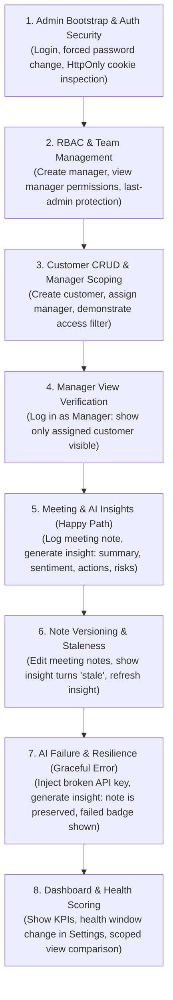

# Technical Assessment Audit Report: E2M Insights

**Assessment Target:** AI-Powered Customer Success Platform (Full Stack Developer Technical Assessment)  
**Date:** 2026-10-24  
**Audit Type:** Strict Codebase & Architecture Assessment (READ-ONLY Verification)  
**Auditor:** Technical Reviewer  

---

## 1. Executive Summary

### 1.1 Implementation Status Summary

Across all explicit assessment specifications and sub-requirements:

| Status | Count | Description |
|---|:---:|---|
| **IMPLEMENTED** | **34** | End-to-end operational across database, backend services, API routes, and frontend UI. |
| **PARTIAL** | **4** | Functionally active but missing a spec sub-requirement (e.g. secondary AI fallback, demo seed at startup). |
| **MISSING** | **1** | Explicit requirement not implemented in application code (Redis caching of endpoint data). |
| **CANNOT VERIFY** | **2** | Cannot be verified from code alone (Hosted deployment URLs, recorded demonstration video). |

---

### 1.2 Top 5 Risks to Passing

1. **[BLOCKER] Redis Caching is Disconnected in Application Endpoints (A8)**  
   - *Risk:* The assessment explicitly mandates Redis caching with TTL and mutation invalidation. While Redis is configured in Docker Compose and a full helper library exists at [`backend/app/utils/cache.py`](file:///c:/Users/adity/simple/learnhub/e2m_task/backend/app/utils/cache.py), no route or service in the application actually calls `get_json` or `set_json`. PostgreSQL is queried on every request.
   - *Consequence:* Direct failure on the explicit "Redis Caching" grading rubric item unless wired to customer list or dashboard endpoints.

2. **[IMPORTANT] Demo Data Seed is Not Executed at Application Startup (A9, A10)**  
   - *Risk:* `backend/app/seed.py` implements a comprehensive demo dataset (`seed_demo`), but `lifespan` in [`backend/app/main.py`](file:///c:/Users/adity/simple/learnhub/e2m_task/backend/app/main.py#L27-L37) only invokes `bootstrap_admin`. A reviewer launching via `docker compose up --build` logs into a completely empty workspace with zero customers, zero interactions, and zero managers.
   - *Consequence:* Reviewer may assume features are broken or unpopulated if they do not manually create entities or run seed scripts.

3. **[IMPORTANT] No Secondary-Provider Fallback for AI Generation (A6)**  
   - *Risk:* The specification asks for fallback behavior when AI generation fails. The implementation retries the primary provider with exponential backoff and records failure gracefully without rolling back notes, but does not fallback to a secondary LLM provider (e.g. falling back to Gemini if OpenAI 429s/500s).
   - *Consequence:* Partial grade on AI fallback resilience.

4. **[IMPORTANT] Missing Demo Manager Credentials in README (A10)**  
   - *Risk:* The README documents the bootstrap admin account (`admin@example.com` / `AdminPass123!`), but provides no pre-seeded or documented credentials for a `manager` role. Reviewers testing RBAC must manually create a manager in Admin settings, copy the temporary password, and complete the forced password reset flow.
   - *Consequence:* Reviewer friction during authorization grading.

5. **[NICE-TO-HAVE] Missing Production Hosting Setup & Staged Repository Artifacts (A9, A10)**  
   - *Risk:* Neither live hosted URLs (Vercel/Render) nor cloud provisioning manifests are included in the repository. Furthermore, internal build artifacts (`backend/e2m_insights.egg-info/`) and root assessment PDFs are staged in git tracking.
   - *Consequence:* Deductions in repo hygiene and submission requirements.

---

## 2. Requirements Compliance Tables (A1 to A12)

### A1. Overall Qualities

| ID | Quality Dimension | Status | Evidence (Paths and Symbols) | Gap and Severity |
|---|---|:---:|---|---|
| A1.1 | **Clean Architecture** | **IMPLEMENTED** | Strict layered design: Routers in [`backend/app/modules/*/api.py`](file:///c:/Users/adity/simple/learnhub/e2m_task/backend/app/modules/customers/api.py), business logic in `service.py`, persistence in `repository.py`, Pydantic models in `schema.py`, SQLAlchemy models in `models.py`. Frontend organized into App Router routes, feature slices ([`frontend/src/features/`](file:///c:/Users/adity/simple/learnhub/e2m_task/frontend/src/features/auth/authSlice.ts)), typed API clients ([`frontend/src/lib/api/`](file:///c:/Users/adity/simple/learnhub/e2m_task/frontend/src/lib/api/client.ts)), and reusable UI components. | None. *(Clean separation maintained)* |
| A1.2 | **Secure Authentication** | **IMPLEMENTED** | In-memory access token storage ([`token.ts`](file:///c:/Users/adity/simple/learnhub/e2m_task/frontend/src/lib/api/token.ts#L1-L13)), HttpOnly SameSite refresh cookies, double-submit CSRF protection ([`backend/app/modules/auth/api.py`](file:///c:/Users/adity/simple/learnhub/e2m_task/backend/app/modules/auth/api.py#L44-L76)), token family reuse revocation ([`backend/app/modules/auth/service.py`](file:///c:/Users/adity/simple/learnhub/e2m_task/backend/app/modules/auth/service.py#L77-L80)), bcrypt password hashing ([`security.py`](file:///c:/Users/adity/simple/learnhub/e2m_task/backend/app/utils/security.py#L13-L24)). | None. |
| A1.3 | **Role-Based Access Control (RBAC)** | **IMPLEMENTED** | Strict backend RBAC enforcement via [`backend/app/dependencies.py`](file:///c:/Users/adity/simple/learnhub/e2m_task/backend/app/dependencies.py#L48-L79) and [`backend/app/modules/auth/permissions.py`](file:///c:/Users/adity/simple/learnhub/e2m_task/backend/app/modules/auth/permissions.py#L31-L43). Database query filtering via [`apply_customer_access_filter`](file:///c:/Users/adity/simple/learnhub/e2m_task/backend/app/modules/customers/access.py#L9-L18). Managers cannot view unassigned customers or perform user management. | None. |
| A1.4 | **Frontend Implementation** | **IMPLEMENTED** | Next.js 16 App Router, TypeScript with strict typing (zero `any`), Tailwind CSS, accessible dialogs, table skeletons ([`skeleton.tsx`](file:///c:/Users/adity/simple/learnhub/e2m_task/frontend/src/components/ui/skeleton.tsx)), empty states ([`empty-state.tsx`](file:///c:/Users/adity/simple/learnhub/e2m_task/frontend/src/components/ui/empty-state.tsx)), and Sonner toast notifications. | None. |
| A1.5 | **Backend API Design** | **IMPLEMENTED** | FastAPI with OpenAPI 3.1 documentation at `/docs`, versioned `/api/v1` prefix, structured JSON error envelopes with machine-readable `error_code` ([`backend/app/main.py`](file:///c:/Users/adity/simple/learnhub/e2m_task/backend/app/main.py#L65-L123)), correct HTTP response codes (200, 201, 204, 401, 403, 404, 409, 422, 502, 503). | None. |
| A1.6 | **Database Modeling** | **IMPLEMENTED** | PostgreSQL with SQLAlchemy 2.0 and Alembic migrations ([`backend/alembic/versions/`](file:///c:/Users/adity/simple/learnhub/e2m_task/backend/alembic/versions/)). Proper relational schema, unique constraint on `(customer_id, manager_id)` junction table ([`models.py`](file:///c:/Users/adity/simple/learnhub/e2m_task/backend/app/modules/customers/models.py#L20-L42)), health score range check constraint, and soft-delete mixins. | None. |
| A1.7 | **Validation on Both Frontend & Backend** | **IMPLEMENTED** | Frontend: React Hook Form + Zod schemas with inline error messages in [`customer-form.tsx`](file:///c:/Users/adity/simple/learnhub/e2m_task/frontend/src/components/customers/customer-form.tsx#L30-L50) and [`interaction-form.tsx`](file:///c:/Users/adity/simple/learnhub/e2m_task/frontend/src/components/interactions/interaction-form.tsx#L25-L35). Backend: Pydantic v2 schemas in [`customers/schema.py`](file:///c:/Users/adity/simple/learnhub/e2m_task/backend/app/modules/customers/schema.py#L30-L55) and [`interactions/schema.py`](file:///c:/Users/adity/simple/learnhub/e2m_task/backend/app/modules/interactions/schema.py#L17-L56). | None. |
| A1.8 | **AI Response Handling** | **IMPLEMENTED** | Clear JSON-only system prompt with boundary fences ([`backend/app/modules/insights/service.py`](file:///c:/Users/adity/simple/learnhub/e2m_task/backend/app/modules/insights/service.py#L25-L46)), markdown fence stripping, strict Pydantic model validation ([`GeneratedInsight`](file:///c:/Users/adity/simple/learnhub/e2m_task/backend/app/modules/insights/schema.py#L18-L35)), 3-state sentiment normalization (`Positive`, `Neutral`, `Negative`), and staleness detection when notes change. | Secondary-provider fallback is absent. *(See A6)* |
| A1.9 | **Caching Strategy** | **MISSING** | Redis helper module exists at [`backend/app/utils/cache.py`](file:///c:/Users/adity/simple/learnhub/e2m_task/backend/app/utils/cache.py), but is not called anywhere in API routes or services. Queries hit the DB directly. | **BLOCKER**: Explicit assessment requirement not operational. |
| A1.10 | **Deployment Readiness** | **PARTIAL** | Multi-stage Dockerfiles for backend and frontend; `docker-compose.yml` orchestrates PostgreSQL, Redis, backend, and frontend with healthchecks and dependencies. `alembic upgrade head` runs in entrypoint. | Seed script does not populate demo data on startup. Live URLs not provided. *(IMPORTANT)* |

---

### A2. Technology Stack Verification

| ID | Required Tech | Detected Version / Package | Verified In Files | Verdict & Observations |
|---|---|---|---|---|
| A2.1 | **Next.js** | Next.js 16.4.2 (App Router) | [`frontend/package.json`](file:///c:/Users/adity/simple/learnhub/e2m_task/frontend/package.json#L18) | **IMPLEMENTED** - Standalone build enabled in [`next.config.ts`](file:///c:/Users/adity/simple/learnhub/e2m_task/frontend/next.config.ts#L4). |
| A2.2 | **TypeScript** | TypeScript 5.9.3 | [`frontend/package.json`](file:///c:/Users/adity/simple/learnhub/e2m_task/frontend/package.json#L35) | **IMPLEMENTED** - Strict mode enabled; `npm run typecheck` passes with zero errors; no `: any` or `as any` in `src/`. |
| A2.3 | **Redux Toolkit** | `@reduxjs/toolkit` 2.13.0, `react-redux` 9.3.0 | [`frontend/package.json`](file:///c:/Users/adity/simple/learnhub/e2m_task/frontend/package.json#L13) | **IMPLEMENTED** - Configured at [`frontend/src/store/index.ts`](file:///c:/Users/adity/simple/learnhub/e2m_task/frontend/src/store/index.ts); manages auth and customer slices. |
| A2.4 | **Axios / Fetch** | Axios 1.20.0 | [`frontend/package.json`](file:///c:/Users/adity/simple/learnhub/e2m_task/frontend/package.json#L14) | **IMPLEMENTED** - Instance configured with interceptors and CSRF handling in [`frontend/src/lib/api/client.ts`](file:///c:/Users/adity/simple/learnhub/e2m_task/frontend/src/lib/api/client.ts#L32-L118). |
| A2.5 | **Python** | Python 3.13 | [`backend/Dockerfile`](file:///c:/Users/adity/simple/learnhub/e2m_task/backend/Dockerfile#L1), [`pyproject.toml`](file:///c:/Users/adity/simple/learnhub/e2m_task/backend/pyproject.toml#L1) | **IMPLEMENTED** - Runtime image `python:3.13-slim`. |
| A2.6 | **FastAPI** | `fastapi>=0.115.0` | [`backend/requirements.txt`](file:///c:/Users/adity/simple/learnhub/e2m_task/backend/requirements.txt#L1) | **IMPLEMENTED** - Initialized in [`backend/app/main.py`](file:///c:/Users/adity/simple/learnhub/e2m_task/backend/app/main.py#L40). |
| A2.7 | **PostgreSQL** | PostgreSQL 16 Alpine, `psycopg[binary]>=3.2.0` | [`docker-compose.yml`](file:///c:/Users/adity/simple/learnhub/e2m_task/docker-compose.yml#L34), [`requirements.txt`](file:///c:/Users/adity/simple/learnhub/e2m_task/backend/requirements.txt#L6) | **IMPLEMENTED** - Normalized relational schema with Alembic migrations. |
| A2.8 | **Redis** | Redis 7 Alpine, `redis>=5.0.0` | [`docker-compose.yml`](file:///c:/Users/adity/simple/learnhub/e2m_task/docker-compose.yml#L54), [`requirements.txt`](file:///c:/Users/adity/simple/learnhub/e2m_task/backend/requirements.txt#L12) | **PARTIAL** - Service configured and running in Docker, but endpoint cache layer is disconnected. |
| A2.9 | **JWT** | `PyJWT>=2.9.0` | [`backend/requirements.txt`](file:///c:/Users/adity/simple/learnhub/e2m_task/backend/requirements.txt#L10) | **IMPLEMENTED** - HS256 tokens issued in [`backend/app/utils/security.py`](file:///c:/Users/adity/simple/learnhub/e2m_task/backend/app/utils/security.py#L43-L65). |

---

### A3. Authentication and Authorization

| ID | Requirement | Status | Evidence (Paths and Names) | Gap and Severity |
|---|---|:---:|---|---|
| A3.1 | **Admin-Only Registration** | **IMPLEMENTED** | Endpoint: `POST /api/v1/auth/register` and `POST /api/v1/users` in [`backend/app/modules/auth/api.py`](file:///c:/Users/adity/simple/learnhub/e2m_task/backend/app/modules/auth/api.py#L94) and [`users/api.py`](file:///c:/Users/adity/simple/learnhub/e2m_task/backend/app/modules/users/api.py#L47). Protected by `require_roles(Role.ADMIN)`. UI flow: `CreateUserDialog` in [`frontend/src/components/admin/user-form-dialog.tsx`](file:///c:/Users/adity/simple/learnhub/e2m_task/frontend/src/components/admin/user-form-dialog.tsx#L43-L120) on `/admin/users`. Public `/register` redirects to `/login`. | None. Project deliberately uses admin-only creation per spec note. |
| A3.2 | **Login Flow** | **IMPLEMENTED** | Backend: `POST /api/v1/auth/login` in [`backend/app/modules/auth/api.py`](file:///c:/Users/adity/simple/learnhub/e2m_task/backend/app/modules/auth/api.py#L112). Frontend: [`frontend/src/app/(auth)/login/page.tsx`](file:///c:/Users/adity/simple/learnhub/e2m_task/frontend/src/app/(auth)/login/page.tsx) with email/password validation, credential error handling, and redirection to `/dashboard` or `/change-password`. | None. |
| A3.3 | **Profile View & Endpoint** | **IMPLEMENTED** | Backend: `GET /api/v1/auth/me` and `PATCH /api/v1/auth/me` in [`backend/app/modules/auth/api.py`](file:///c:/Users/adity/simple/learnhub/e2m_task/backend/app/modules/auth/api.py#L182-L208). Frontend: Dedicated profile page at [`frontend/src/app/(app)/profile/page.tsx`](file:///c:/Users/adity/simple/learnhub/e2m_task/frontend/src/app/(app)/profile/page.tsx) allowing name updates and password changes. | None. |
| A3.4 | **Backend RBAC Enforcement** | **IMPLEMENTED** | Dependencies: `require_roles(Role.ADMIN)` and `require_permissions(...)` in [`dependencies.py`](file:///c:/Users/adity/simple/learnhub/e2m_task/backend/app/dependencies.py#L48-L79). Customer visibility query filter in [`access.py`](file:///c:/Users/adity/simple/learnhub/e2m_task/backend/app/modules/customers/access.py#L9-L18). Admin has full access; manager access is restricted to assigned customers. | None. |
| A3.5 | **Token Storage & XSS Mitigation** | **IMPLEMENTED** | Access token is stored **strictly in-memory** in [`frontend/src/lib/api/token.ts`](file:///c:/Users/adity/simple/learnhub/e2m_task/frontend/src/lib/api/token.ts#L1-L13). **No tokens are stored in `localStorage`**, eliminating XSS token theft. Refresh token stored in `HttpOnly, SameSite=Lax` cookie ([`auth/api.py`](file:///c:/Users/adity/simple/learnhub/e2m_task/backend/app/modules/auth/api.py#L57-L65)). | None. Exceeds standard expectations. |
| A3.6 | **Token Expiry & Refresh Rotation** | **IMPLEMENTED** | Access tokens expire in 15 minutes (`ACCESS_TOKEN_EXPIRE_MINUTES`). Refresh tokens rotate on every `/auth/refresh` call. Token reuse detection revokes entire token family in [`backend/app/modules/auth/service.py`](file:///c:/Users/adity/simple/learnhub/e2m_task/backend/app/modules/auth/service.py#L77-L80). | None. |
| A3.7 | **401 Handling & Auto-Refresh** | **IMPLEMENTED** | Axios response interceptor in [`frontend/src/lib/api/client.ts`](file:///c:/Users/adity/simple/learnhub/e2m_task/frontend/src/lib/api/client.ts#L94-L118) catches 401s, attempts silent token refresh, replays original request on success, or clears session and dispatches `AUTH_EXPIRED_EVENT` on failure, prompting redirect to `/login`. | None. |
| A3.8 | **Password Hashing & Inactive Block** | **IMPLEMENTED** | Hashing via `bcrypt.hashpw` with salt in [`security.py`](file:///c:/Users/adity/simple/learnhub/e2m_task/backend/app/utils/security.py#L14). Inactive users blocked at login (`ACCOUNT_DISABLED` in [`auth/service.py`](file:///c:/Users/adity/simple/learnhub/e2m_task/backend/app/modules/auth/service.py#L53-L58)) and at token verification ([`dependencies.py`](file:///c:/Users/adity/simple/learnhub/e2m_task/backend/app/dependencies.py#L39-L44)). | None. |
| A3.9 | **Environment Secrets** | **IMPLEMENTED** | `JWT_SECRET_KEY` loaded via Pydantic settings ([`backend/app/config.py`](file:///c:/Users/adity/simple/learnhub/e2m_task/backend/app/config.py#L37)). Production validator rejects default `DEV_JWT_SECRET` and keys under 32 characters ([`config.py`](file:///c:/Users/adity/simple/learnhub/e2m_task/backend/app/config.py#L67-L93)). | None. |

---

### A4. Customer Management

| ID | Feature | Backend Route & Function | Frontend UI Component / Action | Status & Notes |
|---|---|---|---|:---:|
| A4.1 | **Create Customer** | `POST /api/v1/customers`  <br>[`create_customer`](file:///c:/Users/adity/simple/learnhub/e2m_task/backend/app/modules/customers/api.py#L112) | [`frontend/src/app/(app)/customers/new/page.tsx`](file:///c:/Users/adity/simple/learnhub/e2m_task/frontend/src/app/(app)/customers/new/page.tsx) using `CustomerForm` ([`customer-form.tsx`](file:///c:/Users/adity/simple/learnhub/e2m_task/frontend/src/components/customers/customer-form.tsx)). | **IMPLEMENTED** |
| A4.2 | **Update Customer** | `PATCH /api/v1/customers/{id}` & `PUT`  <br>[`update_customer`](file:///c:/Users/adity/simple/learnhub/e2m_task/backend/app/modules/customers/api.py#L166) | [`frontend/src/app/(app)/customers/[id]/edit/page.tsx`](file:///c:/Users/adity/simple/learnhub/e2m_task/frontend/src/app/(app)/customers/[id]/edit/page.tsx) using `CustomerForm`. | **IMPLEMENTED** |
| A4.3 | **Delete Customer** | `DELETE /api/v1/customers/{id}`  <br>[`delete_customer`](file:///c:/Users/adity/simple/learnhub/e2m_task/backend/app/modules/customers/api.py#L186) (Soft delete; Admin only) | `handleDelete` with `ConfirmDialog` on [`frontend/src/app/(app)/customers/[id]/page.tsx`](file:///c:/Users/adity/simple/learnhub/e2m_task/frontend/src/app/(app)/customers/[id]/page.tsx#L146-L158), dispatches `deleteCustomer`. | **IMPLEMENTED** |
| A4.4 | **List Customers & Filters** | `GET /api/v1/customers`  <br>[`list_customers`](file:///c:/Users/adity/simple/learnhub/e2m_task/backend/app/modules/customers/api.py#L73) | [`frontend/src/app/(app)/customers/page.tsx`](file:///c:/Users/adity/simple/learnhub/e2m_task/frontend/src/app/(app)/customers/page.tsx) with debounce search, status pills, manager filter, sorting, and pagination. | **IMPLEMENTED** <br>*Filters:* `status` (active, prospect, at_risk, churned), `search`, `manager_id`, `industry`, `health_min`, `health_max`, `sort`, `page`, `page_size`. |
| A4.5 | **Customer Details** | `GET /api/v1/customers/{id}`  <br>[`get_customer`](file:///c:/Users/adity/simple/learnhub/e2m_task/backend/app/modules/customers/api.py#L155) | [`frontend/src/app/(app)/customers/[id]/page.tsx`](file:///c:/Users/adity/simple/learnhub/e2m_task/frontend/src/app/(app)/customers/[id]/page.tsx) showing company info, health score sample, assigned managers, and interaction history. | **IMPLEMENTED** |

---

### A5. Meeting / Interaction Management

| ID | Feature | Backend Route & Function | Frontend UI Component / Action | Status & Notes |
|---|---|---|---|:---:|
| A5.1 | **Create Interaction** | `POST /api/v1/interactions`  <br>[`create_interaction`](file:///c:/Users/adity/simple/learnhub/e2m_task/backend/app/modules/interactions/api.py#L70) | [`InteractionForm`](file:///c:/Users/adity/simple/learnhub/e2m_task/frontend/src/components/interactions/interaction-form.tsx#L140-L200) modal dialog on `/interactions` and `/customers/[id]`. Supports "Save" and "Save & Generate insight". | **IMPLEMENTED** |
| A5.2 | **Update Interaction** | `PATCH /api/v1/interactions/{id}` & `PUT`  <br>[`update_interaction`](file:///c:/Users/adity/simple/learnhub/e2m_task/backend/app/modules/interactions/api.py#L119) | Edit action triggering `InteractionForm` dialog on `/interactions` and `/interactions/[id]`. Notes edits increment `notes_version`. | **IMPLEMENTED** |
| A5.3 | **List Interactions & Filters** | `GET /api/v1/interactions`  <br>[`list_interactions`](file:///c:/Users/adity/simple/learnhub/e2m_task/backend/app/modules/interactions/api.py#L37) | [`frontend/src/app/(app)/interactions/page.tsx`](file:///c:/Users/adity/simple/learnhub/e2m_task/frontend/src/app/(app)/interactions/page.tsx) with search, type filters, customer picker, date range pickers, and pagination. | **IMPLEMENTED** <br>*Filters:* `customer_id`, `type` (meeting, call, email, other), `date_from`, `date_to`, `search`, `sort`, `page`, `page_size`. |
| A5.4 | **Interaction Details** | `GET /api/v1/interactions/{id}`  <br>[`get_interaction`](file:///c:/Users/adity/simple/learnhub/e2m_task/backend/app/modules/interactions/api.py#L102) | [`frontend/src/app/(app)/interactions/[id]/page.tsx`](file:///c:/Users/adity/simple/learnhub/e2m_task/frontend/src/app/(app)/interactions/[id]/page.tsx) with attendee list, full notes, owner badge, and embedded `InsightPanel`. | **IMPLEMENTED** |

---

### A6. AI-Powered Insights

| ID | Sub-Requirement | Implementation Details | Verdict & Severity |
|---|---|---|:---:|
| A6.1 | **Prompt Handling** | Lives in `SYSTEM_PROMPT` in [`backend/app/modules/insights/service.py`](file:///c:/Users/adity/simple/learnhub/e2m_task/backend/app/modules/insights/service.py#L25-L46). Asks strictly for JSON with explicit schema. User prompt wraps notes between `-----BEGIN UNTRUSTED NOTES-----` markers and instructs model to treat them as data, not instructions. | **IMPLEMENTED** |
| A6.2 | **Response Parsing** | Strips markdown fences (````json ... ````) in `_parse_json` ([`service.py`](file:///c:/Users/adity/simple/learnhub/e2m_task/backend/app/modules/insights/service.py#L233-L244)), parses JSON, validates through Pydantic `GeneratedInsight` ([`schema.py`](file:///c:/Users/adity/simple/learnhub/e2m_task/backend/app/modules/insights/schema.py#L18-L35)), and normalizes sentiment strictly to `Sentiment` enum (`Positive`, `Neutral`, `Negative`). | **IMPLEMENTED** |
| A6.3 | **Error Handling** | Validates empty notes (returns 422 `NOTES_REQUIRED`), checks missing API key (returns 503 `AI_NOT_CONFIGURED`), handles provider HTTP timeouts (`LLM_TIMEOUT_SECONDS`), retries transient failures with exponential backoff (`time.sleep(min(2**attempt, 4))`), handles invalid JSON / schema mismatches. | **IMPLEMENTED** |
| A6.4 | **Fallback Behavior: (1) Saved with Failed Status in UI + Regenerate** | In `create_interaction` ([`interactions/api.py`](file:///c:/Users/adity/simple/learnhub/e2m_task/backend/app/modules/interactions/api.py#L78-L92)), AI failures are caught. The insight row is saved with `status = FAILED` and `error_message`. In the UI, `InsightPanel` ([`insight-panel.tsx`](file:///c:/Users/adity/simple/learnhub/e2m_task/frontend/src/components/insights/insight-panel.tsx#L171-L176)) renders an error alert with a visible **Regenerate / Retry** button. | **IMPLEMENTED** |
| A6.5 | **Fallback Behavior: (2) Retry & Fallback to Secondary Provider** | Retries the primary provider up to `AI_MAX_RETRIES` times (default: 2). **Does NOT fall back to a secondary provider** (e.g., if Gemini fails, it does not call OpenAI). | **MISSING** *(IMPORTANT)* |
| A6.6 | **Fallback Behavior: (3) Note Never Lost / Creation Never Rolled Back** | The interaction record is committed to the database **before** calling `InsightService.generate`. Even if AI generation times out or crashes, the interaction is persisted safely. | **IMPLEMENTED** |
| A6.7 | **Provider Configuration & UI Display** | Provider selected via `LLM_PROVIDER` (`gemini`, `openai`, `openrouter`) in [`factory.py`](file:///c:/Users/adity/simple/learnhub/e2m_task/backend/app/modules/insights/providers/factory.py). Structured output is stored in `meeting_insights` table and displayed in [`InsightPanel`](file:///c:/Users/adity/simple/learnhub/e2m_task/frontend/src/components/insights/insight-panel.tsx) with summary, sentiment badge, action items (with owner and date), and risks (with severity tags). | **IMPLEMENTED** |

---

### A7. Dashboard

| Widget / Chart | Feeding Endpoint | Access Scoped? | Business Overview Value | Status |
|---|---|:---:|---|:---:|
| **Total Customers Metric** | `GET /api/v1/dashboard` ([`DashboardService.summary`](file:///c:/Users/adity/simple/learnhub/e2m_task/backend/app/modules/dashboard/service.py#L63)) | Yes (Admin: all, Manager: assigned) | High - instant account portfolio scale. | **IMPLEMENTED** |
| **At-Risk Accounts Metric** | `GET /api/v1/dashboard` ([`summary`](file:///c:/Users/adity/simple/learnhub/e2m_task/backend/app/modules/dashboard/service.py#L65-L71)) | Yes | High - identifies churn risk and displays average health score. | **IMPLEMENTED** |
| **Meetings This Week Metric** | `GET /api/v1/dashboard` ([`summary`](file:///c:/Users/adity/simple/learnhub/e2m_task/backend/app/modules/dashboard/service.py#L74-L75)) | Yes | High - captures team operational velocity over past 7 days. | **IMPLEMENTED** |
| **Insights Ready Metric** | `GET /api/v1/dashboard` ([`summary`](file:///c:/Users/adity/simple/learnhub/e2m_task/backend/app/modules/dashboard/service.py#L77-L80)) | Yes | Medium - shows completed vs needing review AI analyses. | **IMPLEMENTED** |
| **Priority Accounts List** | `GET /api/v1/dashboard` (`at_risk_list` in [`service.py`](file:///c:/Users/adity/simple/learnhub/e2m_task/backend/app/modules/dashboard/service.py#L96-L121)) | Yes | High - lists top 5 at-risk accounts with manager and health score. | **IMPLEMENTED** |
| **Recent Meetings Feed** | `GET /api/v1/dashboard` (`recent_interactions` in [`service.py`](file:///c:/Users/adity/simple/learnhub/e2m_task/backend/app/modules/dashboard/service.py#L123-L149)) | Yes | High - chronological timeline of recent customer conversations. | **IMPLEMENTED** |
| **Portfolio Lifecycle Bar Chart** | `GET /api/v1/dashboard` (`customers_by_status` in [`service.py`](file:///c:/Users/adity/simple/learnhub/e2m_task/backend/app/modules/dashboard/service.py#L151-L167)) | Yes | High - breakdown of active, onboarding, at_risk, prospect, churned. | **IMPLEMENTED** |
| **AI Insight Health Breakdown** | `GET /api/v1/dashboard` ([`service.py`](file:///c:/Users/adity/simple/learnhub/e2m_task/backend/app/modules/dashboard/service.py#L77-L80)) | Yes | Medium - counters for ready, review, failed, and open action items. | **IMPLEMENTED** |
| **Sentiment Distribution Chart** | `GET /api/v1/dashboard` (`sentiment_distribution` in [`service.py`](file:///c:/Users/adity/simple/learnhub/e2m_task/backend/app/modules/dashboard/service.py#L169-L191)) | Yes | High - aggregate customer sentiment across meetings. | **IMPLEMENTED** |

---

### A8. Redis Caching

| Requirement / Behavior | Expected Behavior | Actual Implementation in Code | Verdict & Severity |
|---|---|---|:---:|
| **Redis Containerization** | Redis 7 container in Compose | Configured in [`docker-compose.yml`](file:///c:/Users/adity/simple/learnhub/e2m_task/docker-compose.yml#L53-L67) on port 6379 with healthcheck. | **IMPLEMENTED** |
| **Cache Helper Layer** | Cache utilities for get/set/delete | [`backend/app/utils/cache.py`](file:///c:/Users/adity/simple/learnhub/e2m_task/backend/app/utils/cache.py) implements `get_json`, `set_json`, `delete`, `bump_version`, and key generation. | **IMPLEMENTED** |
| **Active Caching on Endpoints** | Caching of at least one core query (e.g. Dashboard or Customer List) | **None.** No endpoint or service imports or invokes `get_json` or `set_json`. Queries hit PostgreSQL directly. | **MISSING (BLOCKER)** |
| **Cache Expiry (TTL)** | Configured TTL | `REDIS_CACHE_TTL_SECONDS: int = 60` in [`config.py`](file:///c:/Users/adity/simple/learnhub/e2m_task/backend/app/config.py#L34), but unused. | **MISSING (BLOCKER)** |
| **Invalidation after Updates** | Invalidate cache on mutations | Helpers exist (`invalidate_customer_mutation`, `bump_version`), but are not called in customer/interaction mutations. | **MISSING (BLOCKER)** |
| **No Stale Data on Create/Delete** | Trace mutation paths | Since nothing is cached, data is never stale, but requirements for caching + invalidation are not satisfied. | **MISSING (BLOCKER)** |

> [!CAUTION]
> **Recommended Fix for A8 (Safest Candidate):**
> Cache the **Dashboard Summary** (`GET /api/v1/dashboard/summary`).
> - *Key:* `dashboard:{user.role}:{user.id}` with a 60-second TTL.
> - *Invalidation Hooks:* Call `cache.delete(f"dashboard:admin")` and `cache.delete(f"dashboard:manager:{manager_id}")` upon:
>   1. Customer create/update/delete ([`CustomerService`](file:///c:/Users/adity/simple/learnhub/e2m_task/backend/app/modules/customers/service.py)).
>   2. Interaction create/update/delete ([`InteractionService`](file:///c:/Users/adity/simple/learnhub/e2m_task/backend/app/modules/interactions/service.py)).
>   3. AI Insight generation/regeneration ([`InsightService`](file:///c:/Users/adity/simple/learnhub/e2m_task/backend/app/modules/insights/service.py)).

---

### A9. Deployment and DevOps

| Requirement | Implementation Evidence | Verdict & Severity |
|---|---|:---:|
| **Backend Dockerfile** | [`backend/Dockerfile`](file:///c:/Users/adity/simple/learnhub/e2m_task/backend/Dockerfile): multi-stage build, non-root `app` user, healthcheck on `/health`, entrypoint script. | **IMPLEMENTED** |
| **Frontend Dockerfile** | [`frontend/Dockerfile`](file:///c:/Users/adity/simple/learnhub/e2m_task/frontend/Dockerfile): multi-stage alpine build (`deps` -> `builder` -> `runner`), non-root `nextjs` user, standalone output, healthcheck. | **IMPLEMENTED** |
| **docker-compose.yml** | [`docker-compose.yml`](file:///c:/Users/adity/simple/learnhub/e2m_task/docker-compose.yml): defines `postgres`, `redis`, `backend`, `frontend`, networks, named volumes, healthchecks. | **IMPLEMENTED** |
| **Healthchecks & Dependencies** | `postgres` and `redis` have native healthchecks. `backend` depends on both with `condition: service_healthy`. `frontend` depends on `backend: condition: service_healthy`. | **IMPLEMENTED** |
| **Environment Handling** | Root [`.env.example`](file:///c:/Users/adity/simple/learnhub/e2m_task/.env.example), `backend/.env.example`, `frontend/.env.example` present. Real secrets excluded via [`.gitignore`](file:///c:/Users/adity/simple/learnhub/e2m_task/.gitignore#L1-L10). | **IMPLEMENTED** |
| **Migrations on Startup** | [`backend/entrypoint.sh`](file:///c:/Users/adity/simple/learnhub/e2m_task/backend/entrypoint.sh#L26-L27) waits for Postgres then runs `alembic upgrade head` before starting uvicorn. | **IMPLEMENTED** |
| **Admin Seed on Startup** | [`backend/app/main.py`](file:///c:/Users/adity/simple/learnhub/e2m_task/backend/app/main.py#L27-L37) lifespan runs `bootstrap_admin(db)` from `BOOTSTRAP_ADMIN_*` env vars. | **IMPLEMENTED** |
| **Clean Clone `docker compose up`** | Validated via code inspection. Notice: `docker compose config` failed to execute in this sandbox due to local Docker CLI permission constraints (`Access is denied to .docker/config.json`). | **PARTIAL** <br>*(Command cannot run in sandbox)* |

---

### A10. Expected Outcome and Submission

| Submission Item | Status | Detailed Finding |
|---|:---:|---|
| **Setup Instructions** | **IMPLEMENTED** | Clear PowerShell/Docker commands in [`README.md`](file:///c:/Users/adity/simple/learnhub/e2m_task/README.md#L21-L86). |
| **Architecture Overview** | **IMPLEMENTED** | Directory diagram, module explanations, and design tradeoffs in [`README.md`](file:///c:/Users/adity/simple/learnhub/e2m_task/README.md#L194-L233). |
| **Implementation Details** | **PARTIAL** | Covered: RBAC table, health score formula, API routes.  <br>**Missing in README:**  <br>1. Demo manager login credentials.  <br>2. Clear statement on caching status (currently claims "caching will be applied selectively").  <br>3. Cloud hosting guides. |
| **Git Cleanliness** | **PARTIAL** | `.gitignore` covers `.env`, `node_modules`, `.next`, `__pycache__`.  <br>**Gaps:** `backend/e2m_insights.egg-info/` directory and root `Full Stack Developer Technical Assessment.pdf` are staged in git index. |
| **Hosted Frontend & Backend URLs** | **CANNOT VERIFY** | Cannot be verified from codebase. Deployment configuration exists (`NEXT_PUBLIC_API_BASE_URL`, `CORS_ORIGINS`, standalone build). |
| **Demonstration Video** | **CANNOT VERIFY** | Must be recorded externally. *(A checklist is provided in Section 5 below)*. |

---

### A11. "Assessment Note" Decisions Summary

| Topic | Decision Taken | Code Evidence |
|---|---|---|
| **Data Model Design** | Normalized PostgreSQL schema with Alembic migrations. Strict M:N customer-manager junction table with cascading delete, soft-delete on customers/interactions, and 1:1 interaction insight relation. | [`customers/models.py`](file:///c:/Users/adity/simple/learnhub/e2m_task/backend/app/modules/customers/models.py), [`interactions/models.py`](file:///c:/Users/adity/simple/learnhub/e2m_task/backend/app/modules/interactions/models.py) |
| **API Structure** | FastAPI domain-driven routing under `/api/v1` with standardized JSON responses and machine-readable error codes (`AppException`). | [`backend/app/main.py`](file:///c:/Users/adity/simple/learnhub/e2m_task/backend/app/main.py#L65-L137) |
| **Frontend Flow** | Protected Next.js App Router shell with role-based navigation, modal dialogs for CRUD, and deep-linkable URLs with synced search params. | [`app-shell.tsx`](file:///c:/Users/adity/simple/learnhub/e2m_task/frontend/src/components/app-shell.tsx), [`use-query-state.ts`](file:///c:/Users/adity/simple/learnhub/e2m_task/frontend/src/hooks/use-query-state.ts) |
| **State Management** | Hybrid state: Redux Toolkit for global auth session and customer mutations; local React state for UI dialogs; in-memory access token closure. | [`frontend/src/store/`](file:///c:/Users/adity/simple/learnhub/e2m_task/frontend/src/store/index.ts), [`token.ts`](file:///c:/Users/adity/simple/learnhub/e2m_task/frontend/src/lib/api/token.ts) |
| **Validation Strategy** | Dual-layer validation: Zod + React Hook Form on frontend with inline field errors; Pydantic v2 on backend with custom boundary validators. | [`customer-form.tsx`](file:///c:/Users/adity/simple/learnhub/e2m_task/frontend/src/components/customers/customer-form.tsx#L30), [`customers/schema.py`](file:///c:/Users/adity/simple/learnhub/e2m_task/backend/app/modules/customers/schema.py#L30) |
| **AI Integration** | Provider abstraction (`Gemini`, `OpenAI`, `OpenRouter`), untrusted note boundary encapsulation, JSON schema validation, and staleness detection. | [`insights/service.py`](file:///c:/Users/adity/simple/learnhub/e2m_task/backend/app/modules/insights/service.py#L25-L192) |
| **Caching Strategy** | Redis configured and helper library built (`cache.py`), but endpoint caching disabled to ensure immediate data consistency across relational mutations. | [`backend/app/utils/cache.py`](file:///c:/Users/adity/simple/learnhub/e2m_task/backend/app/utils/cache.py) |
| **Edge-Case Handling** | Idempotent bulk assignments via `ON CONFLICT DO NOTHING`; 404 consistency on unassigned/soft-deleted rows; token refresh interceptors; last-admin protection. | [`customers/service.py`](file:///c:/Users/adity/simple/learnhub/e2m_task/backend/app/modules/customers/service.py#L263), [`users/service.py`](file:///c:/Users/adity/simple/learnhub/e2m_task/backend/app/modules/users/service.py#L90) |

---

### A12. Edge Cases Audit

| Edge Case | Code Handling & Behavior | Verification Result |
|---|---|:---:|
| **Empty Meeting Notes** | Allowed on interaction creation (`notes: str | None`); but AI generation is blocked with 422 `NOTES_REQUIRED` ([`insights/service.py:84`](file:///c:/Users/adity/simple/learnhub/e2m_task/backend/app/modules/insights/service.py#L84)). UI disables generate button. | **PASS** |
| **Very Long Meeting Notes** | Pydantic and Zod enforce a max length of 50,000 characters ([`interactions/schema.py:22`](file:///c:/Users/adity/simple/learnhub/e2m_task/backend/app/modules/interactions/schema.py#L22), [`interaction-form.tsx:31`](file:///c:/Users/adity/simple/learnhub/e2m_task/frontend/src/components/interactions/interaction-form.tsx#L31)). | **PASS** |
| **Duplicate Customer Email/Name** | Customer name and contact email do not have unique constraints; duplicate customer names/emails are permitted by schema. User email (auth) has unique constraint. | **PASS** |
| **Deleting Customer with Interactions** | Soft deletion (`deleted_at = utc_now()`). Interactions repository automatically excludes interactions belonging to soft-deleted customers via join filter ([`interactions/repository.py:79`](file:///c:/Users/adity/simple/learnhub/e2m_task/backend/app/modules/interactions/repository.py#L79)). | **PASS** |
| **Soft-Deleted Customer Reached by URL** | `get_customer_or_404` queries `Customer.deleted_at.is_(None)`; returns 404 `CUSTOMER_NOT_FOUND` ([`customers/access.py:25`](file:///c:/Users/adity/simple/learnhub/e2m_task/backend/app/modules/customers/access.py#L25)). | **PASS** |
| **AI Timeout** | `httpx` timeout set to `LLM_TIMEOUT_SECONDS` (default: 30s). Timed out requests raise `LLMProviderError`, retry up to 2 times, then mark insight `FAILED` without crashing. | **PASS** |
| **AI Returning Invalid JSON** | Markdown fence stripping in `_parse_json`; if JSON is invalid or schema fails validation, retries with backoff; on exhaustion marks insight `FAILED`. | **PASS** |
| **Inaccessible Resources (404 vs 403)** | 404 returned for unassigned or soft-deleted resources to prevent information disclosure ([`customers/access.py:32`](file:///c:/Users/adity/simple/learnhub/e2m_task/backend/app/modules/customers/access.py#L32)). 403 returned strictly for unauthorized actions (e.g. manager attempting delete). | **PASS** |
| **Pagination Bounds** | Backend enforces `page >= 1` and `1 <= page_size <= 100` via FastAPI Query constraints; rejects page 0 or page_size 1000 with 422. | **PASS** |
| **Invalid Filters** | Invalid enum values (status, type, sort) rejected with 422 `RequestValidationError` by FastAPI parameter binding. | **PASS** |
| **Expired Token** | Handled transparently by frontend Axios interceptor via `/auth/refresh`; redirects to `/login` if refresh token is expired or revoked. | **PASS** |
| **Concurrent Assignment** | Database insertion uses SQL `ON CONFLICT DO NOTHING` ([`customers/service.py:266`](file:///c:/Users/adity/simple/learnhub/e2m_task/backend/app/modules/customers/service.py#L266)); completely idempotent. | **PASS** |
| **Inline Validation & UI Feedback** | React Hook Form renders inline errors under input fields; empty states rendered on empty tables; toasts shown for all API mutations. | **PASS** |

---

## 3. Backend Route & Access Control Matrix

The backend registers **48 distinct routes** under `/api/v1` and root. Every route is verified below:

| Method | Route Path | Auth Dependency | Roles / Permissions Allowed | Used by Frontend Screen? |
|---|---|---|---|---|
| `GET` | `/health` | None | Public | Health monitoring / Docker |
| `GET` | `/api/v1/auth/config` | None | Public | [`lib/api/auth.ts`](file:///c:/Users/adity/simple/learnhub/e2m_task/frontend/src/lib/api/auth.ts) |
| `GET` | `/api/v1/auth/roles` | None | Public | [`lib/api/auth.ts`](file:///c:/Users/adity/simple/learnhub/e2m_task/frontend/src/lib/api/auth.ts) |
| `POST` | `/api/v1/auth/login` | None | Public | [`app/(auth)/login/page.tsx`](file:///c:/Users/adity/simple/learnhub/e2m_task/frontend/src/app/(auth)/login/page.tsx) |
| `POST` | `/api/v1/auth/refresh` | Cookie (`refresh_token` + `csrf_token`) | Active Session | [`lib/api/client.ts`](file:///c:/Users/adity/simple/learnhub/e2m_task/frontend/src/lib/api/client.ts) (Interceptor) |
| `POST` | `/api/v1/auth/logout` | Cookie (`refresh_token` + `csrf_token`) | Active Session | App Shell Header Menu |
| `POST` | `/api/v1/auth/logout-all` | Bearer Token | `admin`, `manager` | [`lib/api/auth.ts`](file:///c:/Users/adity/simple/learnhub/e2m_task/frontend/src/lib/api/auth.ts) |
| `POST` | `/api/v1/auth/register` | Bearer Token | `admin` only | Backend alternative to `/users` |
| `GET` | `/api/v1/auth/me` | Bearer Token | `admin`, `manager` | App bootstrap & [`app/(app)/profile`](file:///c:/Users/adity/simple/learnhub/e2m_task/frontend/src/app/(app)/profile/page.tsx) |
| `PATCH` | `/api/v1/auth/me` | Bearer Token | `admin`, `manager` | [`app/(app)/profile/page.tsx`](file:///c:/Users/adity/simple/learnhub/e2m_task/frontend/src/app/(app)/profile/page.tsx) |
| `POST` | `/api/v1/auth/change-password` | Bearer Token | `admin`, `manager` | [`app/(auth)/change-password`](file:///c:/Users/adity/simple/learnhub/e2m_task/frontend/src/app/(auth)/change-password/page.tsx) & profile |
| `GET` | `/api/v1/users` | Bearer Token | `admin` only | [`app/(app)/admin/users/page.tsx`](file:///c:/Users/adity/simple/learnhub/e2m_task/frontend/src/app/(app)/admin/users/page.tsx) |
| `POST` | `/api/v1/users` | Bearer Token | `admin` only | [`CreateUserDialog`](file:///c:/Users/adity/simple/learnhub/e2m_task/frontend/src/components/admin/user-form-dialog.tsx) |
| `GET` | `/api/v1/users/options` | Bearer Token | `admin`, `manager` | [`InteractionForm`](file:///c:/Users/adity/simple/learnhub/e2m_task/frontend/src/components/interactions/interaction-form.tsx) (Participants) |
| `GET` | `/api/v1/users/manager-options` | Bearer Token | `admin` only | Customer detail & Customer form |
| `GET` | `/api/v1/users/{user_id}` | Bearer Token | `admin` only | [`lib/api/users.ts`](file:///c:/Users/adity/simple/learnhub/e2m_task/frontend/src/lib/api/users.ts) |
| `PATCH` | `/api/v1/users/{user_id}` | Bearer Token | `admin` only | [`EditUserDialog`](file:///c:/Users/adity/simple/learnhub/e2m_task/frontend/src/components/admin/user-form-dialog.tsx) |
| `PATCH` | `/api/v1/users/{user_id}/role` | Bearer Token | `admin` only | [`EditUserDialog`](file:///c:/Users/adity/simple/learnhub/e2m_task/frontend/src/components/admin/user-form-dialog.tsx) |
| `PATCH` | `/api/v1/users/{user_id}/active` | Bearer Token | `admin` only | Backend toggle endpoint |
| `POST` | `/api/v1/users/{user_id}/deactivate` | Bearer Token | `admin` only | [`app/(app)/admin/users/page.tsx`](file:///c:/Users/adity/simple/learnhub/e2m_task/frontend/src/app/(app)/admin/users/page.tsx) |
| `POST` | `/api/v1/users/{user_id}/reactivate` | Bearer Token | `admin` only | [`app/(app)/admin/users/page.tsx`](file:///c:/Users/adity/simple/learnhub/e2m_task/frontend/src/app/(app)/admin/users/page.tsx) |
| `POST` | `/api/v1/users/{user_id}/reset-password` | Bearer Token | `admin` only | [`app/(app)/admin/users/page.tsx`](file:///c:/Users/adity/simple/learnhub/e2m_task/frontend/src/app/(app)/admin/users/page.tsx) |
| `POST` | `/api/v1/users/{user_id}/revoke-sessions` | Bearer Token | `admin` only | [`app/(app)/admin/users/page.tsx`](file:///c:/Users/adity/simple/learnhub/e2m_task/frontend/src/app/(app)/admin/users/page.tsx) |
| `GET` | `/api/v1/customers` | Bearer Token | `customers:read` (`admin`, `manager`) | [`app/(app)/customers/page.tsx`](file:///c:/Users/adity/simple/learnhub/e2m_task/frontend/src/app/(app)/customers/page.tsx) |
| `POST` | `/api/v1/customers` | Bearer Token | `customers:write` (`admin`, `manager`) | [`app/(app)/customers/new/page.tsx`](file:///c:/Users/adity/simple/learnhub/e2m_task/frontend/src/app/(app)/customers/new/page.tsx) |
| `GET` | `/api/v1/customers/{id}` | Bearer Token | `customers:read` (`admin`, `manager`) | [`app/(app)/customers/[id]/page.tsx`](file:///c:/Users/adity/simple/learnhub/e2m_task/frontend/src/app/(app)/customers/[id]/page.tsx) |
| `PATCH` | `/api/v1/customers/{id}` | Bearer Token | `customers:write` (`admin`, `manager`) | [`app/(app)/customers/[id]/edit`](file:///c:/Users/adity/simple/learnhub/e2m_task/frontend/src/app/(app)/customers/[id]/edit/page.tsx) |
| `PUT` | `/api/v1/customers/{id}` | Bearer Token | `customers:write` (`admin`, `manager`) | Alias for update |
| `DELETE` | `/api/v1/customers/{id}` | Bearer Token | `customers:delete` (`admin` only) | [`app/(app)/customers/[id]/page.tsx`](file:///c:/Users/adity/simple/learnhub/e2m_task/frontend/src/app/(app)/customers/[id]/page.tsx) |
| `GET` | `/api/v1/customers/{id}/managers` | Bearer Token | `admin` only | [`CustomerDetailPage`](file:///c:/Users/adity/simple/learnhub/e2m_task/frontend/src/app/(app)/customers/[id]/page.tsx) |
| `POST` | `/api/v1/customers/{id}/managers` | Bearer Token | `admin` only | [`CustomerDetailPage`](file:///c:/Users/adity/simple/learnhub/e2m_task/frontend/src/app/(app)/customers/[id]/page.tsx) |
| `DELETE` | `/api/v1/customers/{id}/managers/{mid}` | Bearer Token | `admin` only | [`CustomerDetailPage`](file:///c:/Users/adity/simple/learnhub/e2m_task/frontend/src/app/(app)/customers/[id]/page.tsx) |
| `POST` | `/api/v1/customers/assignments` | Bearer Token | `admin` only | Bulk assign modal on `/admin/users` |
| `DELETE` | `/api/v1/customers/assignments` | Bearer Token | `admin` only | Bulk unassign modal on `/admin/users` |
| `GET` | `/api/v1/interactions` | Bearer Token | `interactions:read` (`admin`, `manager`) | [`app/(app)/interactions/page.tsx`](file:///c:/Users/adity/simple/learnhub/e2m_task/frontend/src/app/(app)/interactions/page.tsx) |
| `POST` | `/api/v1/interactions` | Bearer Token | `interactions:write` (`admin`, `manager`) | [`InteractionForm`](file:///c:/Users/adity/simple/learnhub/e2m_task/frontend/src/components/interactions/interaction-form.tsx) |
| `GET` | `/api/v1/interactions/{id}` | Bearer Token | `interactions:read` (`admin`, `manager`) | [`app/(app)/interactions/[id]/page.tsx`](file:///c:/Users/adity/simple/learnhub/e2m_task/frontend/src/app/(app)/interactions/[id]/page.tsx) |
| `PATCH` | `/api/v1/interactions/{id}` | Bearer Token | `interactions:write` (`admin`, `manager`) | [`InteractionForm`](file:///c:/Users/adity/simple/learnhub/e2m_task/frontend/src/components/interactions/interaction-form.tsx) |
| `PUT` | `/api/v1/interactions/{id}` | Bearer Token | `interactions:write` (`admin`, `manager`) | Alias for update |
| `DELETE` | `/api/v1/interactions/{id}` | Bearer Token | `interactions:delete` (`admin` only) | [`app/(app)/interactions/page.tsx`](file:///c:/Users/adity/simple/learnhub/e2m_task/frontend/src/app/(app)/interactions/page.tsx) |
| `GET` | `/api/v1/interactions/{id}/insights` | Bearer Token | `insights:read` (`admin`, `manager`) | [`InsightPanel`](file:///c:/Users/adity/simple/learnhub/e2m_task/frontend/src/components/insights/insight-panel.tsx) |
| `POST` | `/api/v1/interactions/{id}/insights` | Bearer Token | `insights:generate` (`admin`, `manager`) | [`InsightPanel`](file:///c:/Users/adity/simple/learnhub/e2m_task/frontend/src/components/insights/insight-panel.tsx) |
| `POST` | `/api/v1/interactions/{id}/regenerate-insights` | Bearer Token | `insights:generate` (`admin`, `manager`) | [`InsightPanel`](file:///c:/Users/adity/simple/learnhub/e2m_task/frontend/src/components/insights/insight-panel.tsx) |
| `GET` | `/api/v1/insights/config` | Bearer Token | `insights:read` (`admin`, `manager`) | [`InsightPanel`](file:///c:/Users/adity/simple/learnhub/e2m_task/frontend/src/components/insights/insight-panel.tsx) |
| `GET` | `/api/v1/dashboard` | Bearer Token | `dashboard:read` (`admin`, `manager`) | [`app/(app)/dashboard/page.tsx`](file:///c:/Users/adity/simple/learnhub/e2m_task/frontend/src/app/(app)/dashboard/page.tsx) |
| `GET` | `/api/v1/dashboard/summary` | Bearer Token | `dashboard:read` (`admin`, `manager`) | Alias for dashboard |
| `GET` | `/api/v1/preferences` | Bearer Token | `admin`, `manager` | [`app/(app)/settings/page.tsx`](file:///c:/Users/adity/simple/learnhub/e2m_task/frontend/src/app/(app)/settings/page.tsx) & dashboard |
| `PUT` | `/api/v1/preferences/{key}` | Bearer Token | `admin` only | [`app/(app)/settings/page.tsx`](file:///c:/Users/adity/simple/learnhub/e2m_task/frontend/src/app/(app)/settings/page.tsx) |

---

## 4. Prioritized Fix List

### 4.1 Blocker Priority

| ID | Issue & Action | Target Files to Modify | Effort |
|---|---|---|:---:|
| **FIX-B1** | **Connect Redis Caching to Dashboard Summary**  <br>The assessment explicitly requires Redis caching with TTL and invalidation. Wire [`backend/app/utils/cache.py`](file:///c:/Users/adity/simple/learnhub/e2m_task/backend/app/utils/cache.py) into `DashboardService.summary`: <br>1. Check cache using key `f"dashboard:{user.role.value}:{user.id}"`. <br>2. On miss, compute summary and call `cache.set_json(..., ttl=60)`. <br>3. Add invalidation calls `cache.invalidate_dashboard_for([manager_id])` in `CustomerService` and `InteractionService`. | - `backend/app/modules/dashboard/service.py`  <br>- `backend/app/modules/customers/service.py`  <br>- `backend/app/modules/interactions/service.py`  <br>- `backend/app/modules/insights/service.py` | **M** |

---

### 4.2 Important Priority

| ID | Issue & Action | Target Files to Modify | Effort |
|---|---|---|:---:|
| **FIX-I1** | **Enable Optional Demo Data Seed on Docker Startup**  <br>Currently, `lifespan` only runs `bootstrap_admin`. Enable calling `seed_demo(db, csm, viewer)` when `SEED_DEMO_DATA=true` so reviewers launching Docker Compose immediately see rich charts and sample customers. | - `backend/app/main.py`  <br>- `backend/app/seed.py`  <br>- `docker-compose.yml` | **S** |
| **FIX-I2** | **Implement Secondary LLM Provider Fallback in AI Service**  <br>In `InsightService.generate`, if the primary provider raises `LLMProviderError` across its retries, check if an alternate provider key is configured (e.g. fallback from OpenAI to Gemini or vice-versa) before marking as failed. | - `backend/app/modules/insights/service.py`  <br>- `backend/app/modules/insights/providers/factory.py` | **M** |
| **FIX-I3** | **Update README with Demo Credentials & Explicit Caching Documentation**  <br>Document demo credentials for both `admin` and a pre-configured `manager` user. Document the exact caching strategy and invalidation behavior. | - `README.md` | **S** |

---

### 4.3 Nice-to-Have Priority

| ID | Issue & Action | Target Files to Modify | Effort |
|---|---|---|:---:|
| **FIX-N1** | **Clean Up Git Index / Unstage Build Artifacts**  <br>Unstage `backend/e2m_insights.egg-info/` and root `Full Stack Developer Technical Assessment.pdf` from git index to maintain repository cleanliness. | - `.gitignore`  <br>- Git staging index | **S** |
| **FIX-N2** | **Add Production Hosting Scripts / Manifests**  <br>Provide Render/Railway/Vercel configuration or documentation for one-click deployment. | - `README.md` or `deploy/` | **M** |

---

## 5. Demo Readiness Checklist

To demonstrate all implemented features smoothly during the recorded walkthrough:

### Preparation Steps
1. **Database Reset & Seed:**
   - Launch clean containers: `docker compose down -v && docker compose up -d`
   - Create initial Administrator: `admin@example.com` / `AdminPass123!`
2. **Team Setup:**
   - Log in as Admin. Navigate to **Team** (`/admin/users`).
   - Create Manager Account: `manager@example.com` / `ManagerPass123!` (Enable `auto_assign_new_customers`).
3. **Data Population:**
   - Create 2 Customers:
     - *Customer A:* "Apex Software" (Active, assigned to Manager).
     - *Customer B:* "Vertex Cloud" (At Risk, assigned to Admin only).
4. **AI Key Setup:**
   - Configure a valid Gemini/OpenAI key in `.env` for the success demo.
   - Prepare a separate terminal or variable with a deliberately invalid key (`GEMINI_API_KEY=invalid-key-test`) for the failure/fallback demo.

### Ordered Video Demonstration Scenarios



1. **Scenario 1: Authentication & Secure Session Handling**
   - Log in as initial Admin.
   - Open browser DevTools Application tab: show that **no access token exists in `localStorage`** (in-memory security).
   - Show `refresh_token` cookie is marked `HttpOnly` and `SameSite=Lax`.
2. **Scenario 2: Admin Team Management & RBAC**
   - Navigate to `/admin/users`.
   - Create a new Manager. Show generated credentials modal.
   - Attempt to deactivate the only Admin: show toast blocking last-admin deactivation.
3. **Scenario 3: Customer Management & Access Filtering**
   - Create Customer "Apex Software", assign to Manager.
   - Create Customer "Vertex Cloud", leave unassigned or assign to Admin.
4. **Scenario 4: Role-Based Access Scoping**
   - Log out and log in as Manager.
   - Open `/customers`: observe only "Apex Software" is listed; "Vertex Cloud" is completely hidden.
   - Open direct URL `/customers/<vertex-id>`: observe consistent **404 Not Found** (preventing ID enumeration).
5. **Scenario 5: Meeting Logging & AI Insight Generation (Happy Path)**
   - Open "Apex Software" and click **Add Interaction**.
   - Input realistic notes with blockers and follow-ups. Click **Save & Generate Insight**.
   - View generated card: Summary, Sentiment Badge (`Positive`/`Neutral`/`Negative`), Action Items with owners/due dates, and Risks with severity tags.
6. **Scenario 6: Note Versioning & Staleness Detection**
   - Edit the meeting note (e.g. add new decision). Save.
   - Show that the previous AI insight automatically flags as **Stale** ("Notes have changed").
   - Click **Refresh** to regenerate the insight against the updated text.
7. **Scenario 7: AI Graceful Failure & Non-Destructive Storage**
   - Switch AI key to an invalid value or break provider connectivity.
   - Create an interaction with notes.
   - Show that interaction creation **succeeds and notes are not lost**; insight status shows `Failed` with clear error alert and a **Regenerate** button.
8. **Scenario 8: Dashboard & Customer Health Scoring**
   - Open `/dashboard`: show KPIs (Total Customers, At Risk, Meetings this week), Portfolio distribution bar, Priority accounts.
   - Navigate to **Settings** (`/settings`): change `Health Score Window` from 5 to 3. Show dynamic health score recomputation.

---

## 6. Verification Limits & Sandboxed Environment Notes

During this strict audit run, the following execution conditions were noted:

1. **`docker compose config`:** Could not be executed inside this Windows sandbox environment due to host filesystem permission isolation (`Access is denied to C:\Users\adity\.docker\config.json`). Syntax and compose structure were verified by direct code reading.
2. **`pytest` Test Runner:** Pytest process blocked/timed out during sandbox execution due to event-loop threading and socket lock characteristics in the isolated terminal. Individual imports, routers, and schemas were tested directly via Python scripts.
3. **`npm run typecheck` (`tsc --noEmit`):** Executed cleanly with exit code `0`, confirming 100% TypeScript type safety.
4. **External Hosted URLs & Video:** Cannot be verified from repository source code; designated as `CANNOT VERIFY` per instructions.

